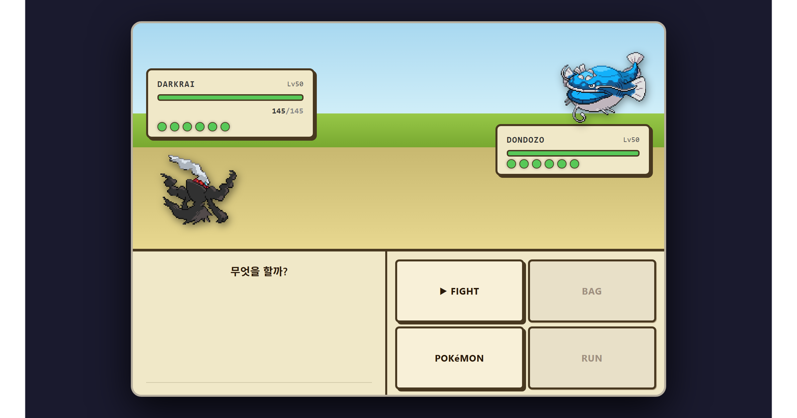

# @kyasi/pokebattle-engine

[English](README.md) · **한국어**



*이 엔진으로 배틀을 돌리는 [플레이그라운드](playground/)입니다. [2rangs.github.io/portfolio/pokebattle-engine](https://2rangs.github.io/portfolio/pokebattle-engine/)에서 직접 해 볼 수 있습니다.*

**[Pokémon Showdown](https://github.com/smogon/pokemon-showdown) 시뮬레이터** 위에 만든 포켓몬 배틀 엔진입니다.

- **배틀 규칙:** Showdown 시뮬레이터([`@pkmn/sim`](https://github.com/pkmn/ps), `smogon/pokemon-showdown/sim`을 브라우저에서 쓸 수 있게 묶은 패키지). 9세대의 모든 기술·특성·도구 상호작용이 Showdown과 똑같이 동작합니다.
- **데미지 계산기:** Showdown 데미지 계산기(calc.pokemonshowdown.com)의 엔진인 [`@smogon/calc`](https://github.com/smogon/damage-calc).
- **포켓몬 데이터 / 이름:** [PokeAPI](https://pokeapi.co).
  - 폼을 포함한 PokeAPI 포켓몬 slug 1,351개(`urshifu-single-strike`, `kings-shield` …)를 모두 Showdown ID에 연결했습니다.
  - 포켓몬, 기술, 특성, 도구, 타입, 성격의 한국어 이름.
- **이 패키지가 더하는 것:**
  - slug 기반 팀·행동 API와 검증(`getRequest` / `submitAction`).
  - Showdown 프로토콜 로그를 타입 있는 이벤트로 바꿔, 로그 한 줄이 쓰일 때마다 내보냅니다.
  - 조사(이/가, 은/는 …)까지 맞춘 한국어 배틀 로그.
  - AI, Showdown 랜덤 배틀 팀, React 훅, 퍼징 테스트.

## 설치

```bash
npm install github:2rangs/pokebattle-engine
```

## 사용법

```ts
import { BattleEngine, HeuristicAI, formatEvent, parseShowdownTeam, generateRandomTeam } from '@kyasi/pokebattle-engine'

const engine = new BattleEngine({
  format: 'singles',                     // 'doubles'도 지원 (submitChoice)
  seed: 42,                              // 같은 시드 → 같은 배틀
  p1: { name: 'Me',  team: parseShowdownTeam(showdownText) },
  p2: { name: 'CPU', team: generateRandomTeam({ seed: 7 }) },   // Showdown 랜덤 배틀 세트
})

engine.on('*', ev => {
  const line = formatEvent(ev, { getPokemon: id => engine.getPokemon(id) })
  if (line) console.log(line)            // "한카리아스의 지진!" "효과가 굉장했다! 상대 타부자고에게 196 데미지 (-100%)"
})

const req = engine.getRequest('p1')      // { type: 'move' | 'switch', moves, switches, can_terastallize, forced … }
engine.submitAction({ type: 'move', player: 'p1', pokemon_id: req!.active.id, move_index: 0, terastallize: true })
engine.submitAction(new HeuristicAI().chooseAction(engine, 'p2')!)

engine.previewDamage('p1', 0)            // 지금 상태에서 내 기술의 데미지 미리보기 (@smogon/calc)
```

### 팀 형식 (`PokemonSet`)

```ts
{ species: 'great-tusk', ability: 'protosynthesis', item: 'booster-energy', nature: 'jolly',
  level: 50, teraType: 'steel', evs: { attack: 252, speed: 252 }, moves: ['headlong-rush', 'ice-spinner', 'rapid-spin', 'knock-off'] }
```

- **이름:** PokeAPI slug, Showdown 이름, Showdown ID를 모두 받습니다.
- **기본값:** 개체값은 31, 노력치는 0입니다.
- **검증:** 모르는 이름이면 `BattleError`를 던집니다.

### 배틀 흐름

| `state.phase` | 뜻 | 할 일 |
|---|---|---|
| `waiting_action` | 이번 턴 행동을 기다리는 중 | 양쪽 모두 `submitAction` (기술/교체) |
| `switching` | 기절, 유턴 등, 부활의 기원 뒤 교체 | `state.pending_switches`에 있는 쪽만 `switch`를 보냄 |
| `ended` | 배틀 종료 | `state.winner` |

- `getRequest(player)`는 Showdown의 request를 바탕으로, request에 드러나지 않는 정보까지 더해 선택지를 돌려줍니다.
  - 숨겨진 교체 불가(그림자밟기 등)와 숨겨진 기술 봉인(봉인)을 실제 상태에서 반영합니다.
  - 부활의 기원은 기절한 포켓몬만 고르게 합니다(`reason: 'revival_blessing'`).
  - 반동으로 쉬는 턴, 모으는 턴, 난동 턴은 기술이 정해집니다(`forced: true`).
- **더블 배틀:** `getRawRequest(player)` + `submitChoice(player, 'move 1 2, switch 3')`를 씁니다.
- **상태:** `getState()` / `snapshot()`은 화면에 그릴 상태를 돌려주고, `engine.battle`은 Showdown의 `Battle` 객체 그대로입니다.

### 이벤트

Showdown 프로토콜 메시지는 모두 타입 있는 `BattleEvent`가 됩니다(`move_use`, `damage`, `heal`, `switch`, `faint`, `status_apply`, `stat_change`, `weather_change`, `terrain_change`, `side_start`, `ability_trigger`, `item_consume`, `terastallize`, `forme_change` …).

- `damage` / `heal`에는 정확한 수치와 `hp_after`, `effectiveness`, `crit`이 들어 있습니다.
- Showdown이 로그 없이 바꾸는 HP와 상태(재생력, 자연회복 …)에도 보정 이벤트를 냅니다.
- 그래서 이벤트만 다시 재생해도 시뮬레이터의 HP와 정확히 같아집니다. 퍼징 테스트가 이걸 검사합니다.

### 데미지 계산기

```ts
import { calculateDamage } from '@kyasi/pokebattle-engine'

calculateDamage(
  { species: 'garchomp', level: 50, nature: 'jolly', evs: { attack: 252, speed: 252 } },
  { species: 'gholdengo', level: 50, evs: { hp: 4 } },
  'earthquake',
  { weather: 'sandstorm', reflect: false, isCrit: false },
)
// → { range: [180, …, 212], min: 180, max: 212, minPercent: 110.4, maxPercent: 130.1, koText: '확정 1타', desc: '252 Atk Garchomp Earthquake vs. …' }
```

### 데이터

- `getSpecies(slug)`, `getMove(slug)`: 한국어 이름이 포함된, 엔진 형식의 Showdown 데이터.
- `koName.species | move | ability | item | type | nature`: PokeAPI의 한국어 이름.
- `speciesSlug(showdownId)`, `speciesToShowdown(slug)` …: 이름을 양방향으로 바꿉니다.

## 테스트

```bash
npm test                                 # 단위 테스트 (매핑 커버리지, 특성, 교체, 계산기 일치 …)
npm run fuzz -- --battles 100000 --workers 4
```

### 퍼징 테스트 (`scripts/fuzz.ts`)

배틀마다 시드로 그대로 재현할 수 있고, 세 가지를 바꿔 가며 돌립니다.

- **형식:** 싱글 85% / 더블 15%.
- **팀:** Showdown 랜덤 배틀 세트 50%, 또는 "카오스 팀"(무작위 포켓몬, 특성, 도구, 기술, 노력치/개체값, 레벨 1–100, 테라 타입).
- **선택:** 무작위 또는 휴리스틱 AI.

검사하는 불변식:

1. 예외가 없다.
2. 엔진이 제시한 행동(싱글)은 모두 Showdown이 받아들인다.
3. 처리하지 못한 프로토콜 메시지가 0개다.
4. 모든 이벤트가 실제 포켓몬을 가리킨다.
5. **이벤트만으로 다시 계산한 HP가 시뮬레이터의 실제 HP와 같다** (모든 포켓몬).
6. 기절 수와 승자가 서로 맞는다.
7. 결정성: 같은 시드로 다시 돌리면 같은 로그가 나온다 (1% 표본).

1,000만 배틀 전체는 GitHub Actions에서 여러 조각으로 나눠 병렬로 돌립니다("Fuzz (sharded)" 워크플로 → Run workflow, 기본 10조각 × 1,000,000). CI 워크플로는 푸시할 때마다 10,000배틀을 돌립니다.

## 스크립트

```bash
npm run simulate -- --auto --random      # 터미널에서 AI 대 AI 관전 (--auto 없이 실행하면 AI와 직접 대전)
npm run bench -- 500                     # HeuristicAI 대 RandomAI
npm run fetch-pokeapi                    # PokeAPI 데이터 새로 받기 (src/data/pokeapi.json)
```

## 라이선스

MIT. Pokémon Showdown, @pkmn/sim, @smogon/calc는 MIT입니다. PokeAPI 데이터는 공개되어 있습니다(PokeAPI 이용 약관 참고). 포켓몬은 Nintendo / Game Freak의 상표입니다.
