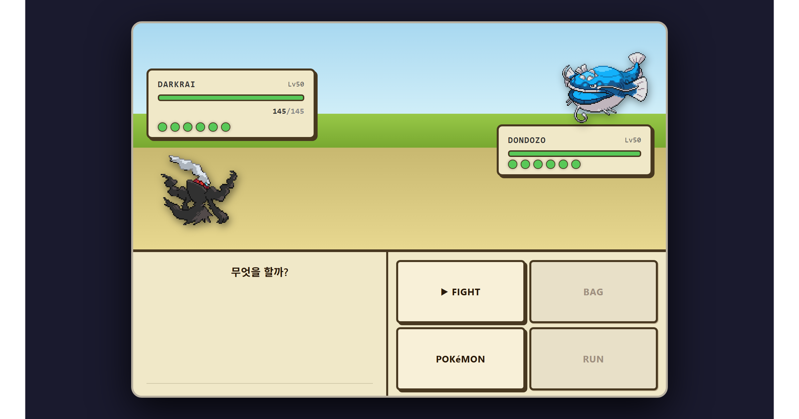

# @kyasi/pokebattle-engine

**English** · [한국어](README.ko.md)



*The [playground](playground/) running a battle on this engine. Try it at [2rangs.github.io/portfolio/pokebattle-engine](https://2rangs.github.io/portfolio/pokebattle-engine/).*

A Pokémon battle engine built on the **[Pokémon Showdown](https://github.com/smogon/pokemon-showdown) simulator**.

- **Battle mechanics:** Showdown's simulator ([`@pkmn/sim`](https://github.com/pkmn/ps), a browser-friendly package of `smogon/pokemon-showdown/sim`). Every Gen 9 move, ability and item interaction behaves exactly as it does on Showdown.
- **Damage calculator:** [`@smogon/calc`](https://github.com/smogon/damage-calc), the engine behind the Showdown damage calculator (calc.pokemonshowdown.com).
- **Pokémon data / names:** [PokeAPI](https://pokeapi.co).
  - All 1,351 PokeAPI Pokémon slugs (`urshifu-single-strike`, `kings-shield` …), forms included, are mapped to Showdown IDs.
  - Korean names for Pokémon, moves, abilities, items, types and natures.
- **This package adds on top:**
  - A slug-based team and action API plus validation (`getRequest` / `submitAction`).
  - Typed events converted from Showdown protocol logs, emitted as each log line is written.
  - Korean battle logs with correct particles (이/가, 은/는 …).
  - AI, Showdown random-battle teams, a React hook, and fuzz testing.

## Install

```bash
npm install github:2rangs/pokebattle-engine
```

## Usage

```ts
import { BattleEngine, HeuristicAI, formatEvent, parseShowdownTeam, generateRandomTeam } from '@kyasi/pokebattle-engine'

const engine = new BattleEngine({
  format: 'singles',                     // 'doubles' also supported (submitChoice)
  seed: 42,                              // same seed → same battle
  p1: { name: 'Me',  team: parseShowdownTeam(showdownText) },
  p2: { name: 'CPU', team: generateRandomTeam({ seed: 7 }) },   // Showdown random-battle sets
})

engine.on('*', ev => {
  const line = formatEvent(ev, { getPokemon: id => engine.getPokemon(id) })
  if (line) console.log(line)            // "한카리아스의 지진!" "효과가 굉장했다! 상대 타부자고에게 196 데미지 (-100%)"
})

const req = engine.getRequest('p1')      // { type: 'move' | 'switch', moves, switches, can_terastallize, forced … }
engine.submitAction({ type: 'move', player: 'p1', pokemon_id: req!.active.id, move_index: 0, terastallize: true })
engine.submitAction(new HeuristicAI().chooseAction(engine, 'p2')!)

engine.previewDamage('p1', 0)            // damage preview of my move against the current state (@smogon/calc)
```

### Team format (`PokemonSet`)

```ts
{ species: 'great-tusk', ability: 'protosynthesis', item: 'booster-energy', nature: 'jolly',
  level: 50, teraType: 'steel', evs: { attack: 252, speed: 252 }, moves: ['headlong-rush', 'ice-spinner', 'rapid-spin', 'knock-off'] }
```

- **Names:** PokeAPI slugs, Showdown names and Showdown IDs are all accepted.
- **Defaults:** IVs default to 31 and EVs to 0.
- **Validation:** unknown names throw `BattleError`.

### Battle flow

| `state.phase` | Meaning | What to do |
|---|---|---|
| `waiting_action` | Waiting for this turn's actions | Both sides `submitAction` (move/switch) |
| `switching` | Replacement after a faint / U-turn etc. / Revival Blessing | Only the sides in `state.pending_switches` submit a `switch` |
| `ended` | The battle is over | `state.winner` |

- `getRequest(player)` returns a decision based on Showdown's request, plus details hidden from the request:
  - Hidden trapping (Shadow Tag etc.) and hidden disables (Imprison) are reflected from live state.
  - Revival Blessing offers only fainted Pokémon (`reason: 'revival_blessing'`).
  - Recharge, charging and rampage turns force the move (`forced: true`).
- **Doubles:** use `getRawRequest(player)` + `submitChoice(player, 'move 1 2, switch 3')`.
- **State:** `getState()` / `snapshot()` return state for display, and `engine.battle` is the Showdown `Battle` object itself.

### Events

Every Showdown protocol message becomes a typed `BattleEvent` (`move_use`, `damage`, `heal`, `switch`, `faint`, `status_apply`, `stat_change`, `weather_change`, `terrain_change`, `side_start`, `ability_trigger`, `item_consume`, `terastallize`, `forme_change` …).

- `damage` / `heal` carry exact amounts plus `hp_after`, `effectiveness` and `crit`.
- HP and status changes that Showdown applies without a log line (Regenerator, Natural Cure …) also get compensating events.
- So replaying the event stream alone matches the simulator's HP exactly; the fuzz test checks this.

### Damage calculator

```ts
import { calculateDamage } from '@kyasi/pokebattle-engine'

calculateDamage(
  { species: 'garchomp', level: 50, nature: 'jolly', evs: { attack: 252, speed: 252 } },
  { species: 'gholdengo', level: 50, evs: { hp: 4 } },
  'earthquake',
  { weather: 'sandstorm', reflect: false, isCrit: false },
)
// → { range: [180, …, 212], min: 180, max: 212, minPercent: 110.4, maxPercent: 130.1, koText: '확정 1타', desc: '252 Atk Garchomp Earthquake vs. …' }
```

### Data

- `getSpecies(slug)`, `getMove(slug)`: Showdown data in engine format, including Korean names.
- `koName.species | move | ability | item | type | nature`: Korean names from PokeAPI.
- `speciesSlug(showdownId)`, `speciesToShowdown(slug)` …: convert names in both directions.

## Testing

```bash
npm test                                 # unit tests (mapping coverage, abilities, switching, calc parity …)
npm run fuzz -- --battles 100000 --workers 4
```

### Fuzz tests (`scripts/fuzz.ts`)

Each battle is reproducible from its seed and varies three things:

- **Format:** singles 85% / doubles 15%.
- **Teams:** Showdown random-battle sets 50%, or "chaos teams" (random species, abilities, items, moves, EVs/IVs, levels 1–100, tera types).
- **Choices:** random or heuristic AI.

Invariants checked:

1. No exceptions.
2. Every action the engine offers (singles) is accepted by Showdown.
3. Zero unhandled protocol messages.
4. Every event refers to a real Pokémon.
5. **HP rebuilt from events alone equals the simulator's actual HP** (every Pokémon).
6. Faint count and winner are consistent.
7. Determinism: re-running the same seed gives the same log (1% sample).

The full 10 million battles run in parallel shards on GitHub Actions ("Fuzz (sharded)" workflow → Run workflow; default 10 shards × 1,000,000). The CI workflow runs 10,000 battles on every push.

## Scripts

```bash
npm run simulate -- --auto --random      # watch AI vs AI in the terminal (without --auto you play against the AI)
npm run bench -- 500                     # HeuristicAI vs RandomAI
npm run fetch-pokeapi                    # refresh PokeAPI data (src/data/pokeapi.json)
```

## License

MIT. Pokémon Showdown, @pkmn/sim and @smogon/calc are MIT. PokeAPI data is publicly available (see PokeAPI's terms of use). Pokémon is a trademark of Nintendo / Game Freak.
